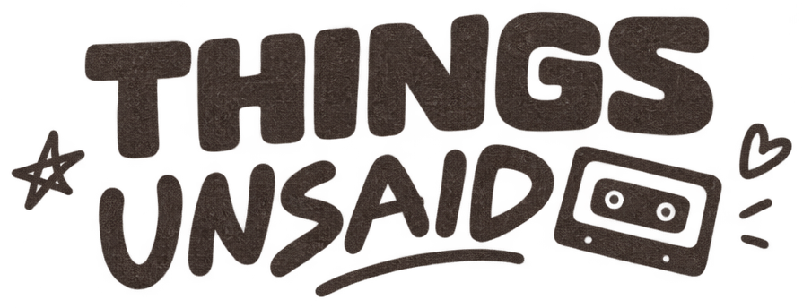
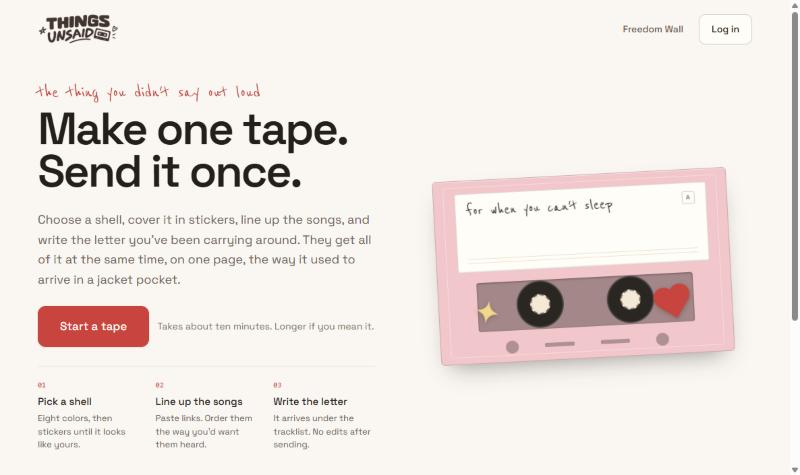
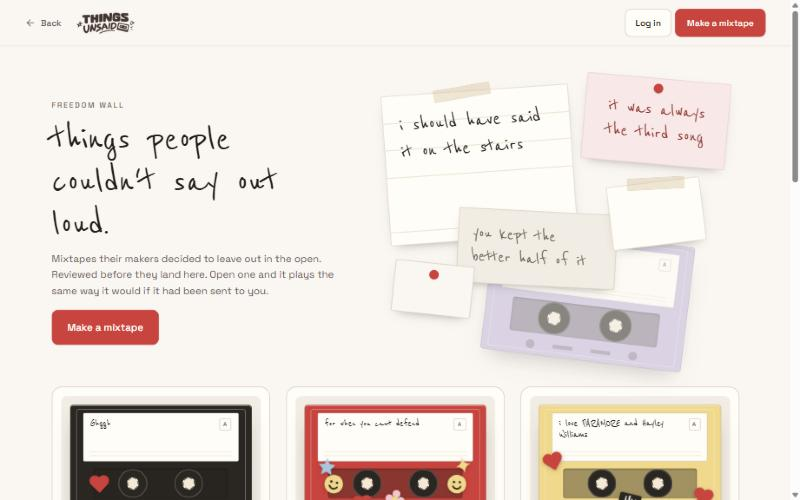

  

<strong>Make one tape. Send it once.</strong>

  <a href="https://thingsunsaid.vercel.app">thingsunsaid.vercel.app</a>

---

Some things are easier to say through a song.

Things Unsaid is a web app for the thing you didn't say out loud. You choose a
cassette shell, cover it in stickers, line up the songs in the order you want
them heard, and write the letter you have been carrying around. Whoever opens
the link gets all of it at once, on one page — the way it used to arrive in a
jacket pocket.

One tape. One person. One link.

## Why it exists

A playlist is a list. A mixtape was a decision: these songs, this order, for
you, now. The work of making one was part of the message, and the object
carried it — the handwriting on the label, the tape running out mid-song.

Streaming kept the songs and lost all of that. Things Unsaid is a small attempt
to put it back: something you make deliberately, send once, and cannot edit
after it has been opened.

## What you can make

**A cassette you decorate.** Eight shell colours, a label you write in your own
hand, and stickers you place where you want them. No two look alike unless you
make them so.

**Up to five songs.** Paste a YouTube link and the song arrives with its title
and cover art. Set where each one starts and stops, so the part you meant is
the part that plays.

**A letter underneath.** The tracklist says what you chose. The letter says why.
It arrives on the same page, under the songs, in a hand that looks written
rather than typed.

**One link, fourteen days.** A private mixtape goes to one person and stops
answering two weeks later. It was never meant to be a permanent archive.

  

## The Freedom Wall

Not everything is for one person. The Freedom Wall is where mixtapes go when
their makers decide to leave them in the open — the ones with no particular
recipient, or with one who will never be told.

Every submission is read by a moderator before anyone else sees it. A mixtape
the wall accepts keeps its place; only private links fade. Anyone can read the
wall without an account.

It is public and it is not anonymous: a mixtape on the wall carries the name of
the person who made it.

  

## About this repository

This is the public home of Things Unsaid: what it is, what it does, and where
to find it. The application's source code lives in a private repository.

## Credits

Things Unsaid was made by **Justine Pelgone** and **Yzekeil Viñas**, built
around the connection between music, memory, and the feelings we leave
unspoken.

*For the words you couldn't say, and the songs that said them for you.*
